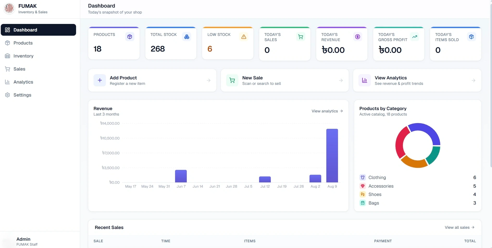
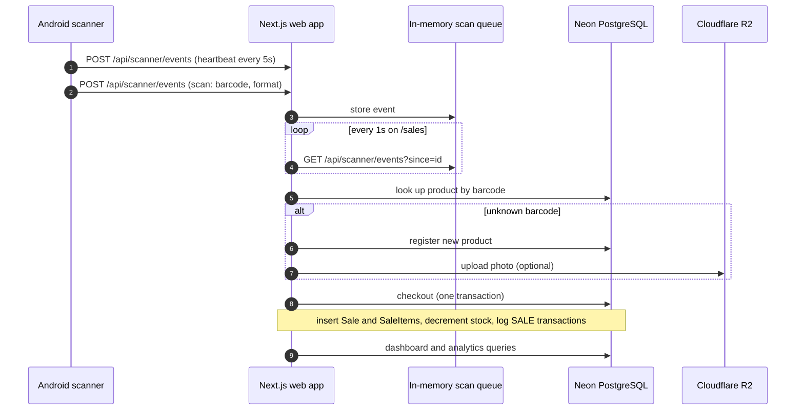
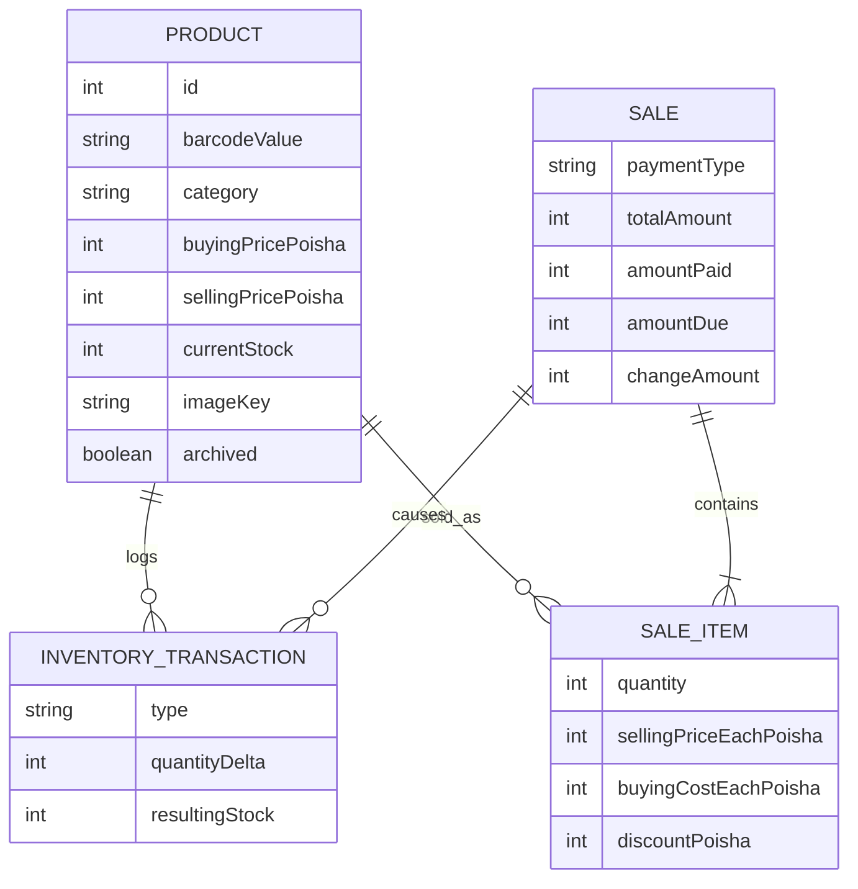

<div align="center">



<p><code>An Android barcode scanner remote paired with a Next.js inventory, POS and analytics web app for a retail shop</code></p>

<p>
<a href="https://fumak-inventory.vercel.app"></a>
<a href="https://github.com/Saji-d/fumak-inventory"></a>

</p>

<p>


</p>

<p>
<a href="#-overview">Overview</a> · <a href="#-highlights">Highlights</a> · <a href="#-preview">Preview</a> · <a href="#-architecture">Architecture</a> · <a href="#-tech-stack">Tech Stack</a> · <a href="#-getting-started">Getting Started</a> · <a href="#-project-structure">Structure</a> · <a href="#-known-gaps">Known Gaps</a> · <a href="#-roadmap">Roadmap</a> · <a href="#-author">Author</a>
</p>

</div>


## ◈ Overview

FUMAK is built for one shop that sells clothing, shoes, bags and accessories carrying manufacturer barcodes. Staff scan a product with a phone, look it up on the desktop, ring up a sale and watch revenue and stock numbers update, without adopting a full POS or accounting suite.

It has two apps that talk over the local network:

- **`app/` is the Android scanner.** A thin remote with no database. It decodes barcodes on-device with ML Kit and POSTs the value to the web app.
- **`web/` is the Next.js app.** It owns all product, stock and sales data in Neon PostgreSQL through Prisma. It also stores product photos in Cloudflare R2.

> **Honest scope.** FUMAK is not a general POS or accounting system and does not generate barcodes. It has no authentication and no automated tests yet (see [Known Gaps](#-known-gaps)).


## ◈ Highlights

<table width="100%">
<tr>
<td width="33%" valign="top">

**Phone as a scanner**<br/>
CameraX and ML Kit decode EAN, UPC, Code 39, 93 and 128 and QR codes fully on-device.

</td>
<td width="33%" valign="top">

**Live scan feed**<br/>
The `/sales` page polls the scan queue every second and shows a Connected badge driven by a 5 second heartbeat.

</td>
<td width="33%" valign="top">

**Point of sale**<br/>
Multi-item cart with per-line discounts, change calculation, receipts and a cart that survives a page refresh.

</td>
</tr>
<tr>
<td width="33%" valign="top">

**Atomic checkout**<br/>
One database transaction inserts the sale and its items, decrements stock and logs a `SALE` entry per item.

</td>
<td width="33%" valign="top">

**Inventory audit ledger**<br/>
Every add, remove, adjust and sale is recorded with the resulting stock level snapshot.

</td>
<td width="33%" valign="top">

**Accurate profit history**<br/>
Sale lines keep the selling price, buying cost and discount at the time of sale. Money is stored as integer poisha.

</td>
</tr>
<tr>
<td width="33%" valign="top">

**Dashboard and analytics**<br/>
KPI tiles, category breakdown and period filters (today, month, 3 or 6 months, year, custom) with a revenue chart.

</td>
<td width="33%" valign="top">

**Product photos**<br/>
Images are uploaded to Cloudflare R2 and referenced by key, never stored in Postgres.

</td>
<td width="33%" valign="top">

**Safe deletes**<br/>
Products are archived rather than removed, so historical sales stay intact.

</td>
</tr>
</table>


## ◈ Preview

<div align="center">

</div>

Open the [live demo](https://fumak-inventory.vercel.app) to browse the web app.


## ◈ Architecture

The phone never touches the database or R2. It only knows the desktop LAN address. All business logic lives in the Next.js API routes.





Scan events and heartbeats live only in server memory (`web/src/lib/scannerEvents.ts`). They are transient signals, not business data.


## ◈ Tech Stack

| Layer | Technologies | Purpose |
|---|---|---|
| Android | Kotlin, Jetpack Compose (Material 3), Navigation Compose | Scanner UI and desktop connection profiles |
| Scanning | CameraX, Google ML Kit Barcode Scanning | On-device barcode decoding |
| Networking | `HttpURLConnection` | One dependency-free POST for scans and heartbeats |
| Web | Next.js 16 (App Router), React 19, TypeScript | POS, inventory and analytics UI plus API routes |
| Styling | Tailwind CSS v4, lucide-react | Interface |
| Data | Prisma 6, Neon PostgreSQL | Products, sales, ledger and settings |
| Storage | Cloudflare R2 through `@aws-sdk/client-s3` | Product photos only |
| Charts | Recharts | Revenue over time |
| Build | Gradle (Kotlin DSL), minSdk 24, compileSdk 35 | Android build |


## ◈ Getting Started

### Web app (start here)

**Prerequisites:** Node.js 20 or newer, a Neon PostgreSQL database and optionally a Cloudflare R2 bucket for product photos.

```bash
cd web
npm install
```

Create `web/.env` with these variable names (set your own values):

```bash
DATABASE_URL=
R2_ACCESS_KEY_ID=
R2_SECRET_ACCESS_KEY=
R2_ENDPOINT=
R2_BUCKET_NAME=
```

The R2 variables are only needed for product photos.

```bash
npx prisma migrate deploy
npx prisma generate
npm run db:seed              # optional sample data
npm run dev -- -p 3000       # http://localhost:3000
```

### Android scanner

**Prerequisites:** Android Studio, a JDK 17 toolchain and a device or emulator on API 24 or newer, on the same network as the web app.

```bash
git clone https://github.com/Saji-d/fumak-inventory.git
cd fumak-inventory
./gradlew assembleDebug      # use gradlew.bat on Windows
adb install -r app/build/outputs/apk/debug/app-debug.apk
```

### Pairing

1. Run the web app and note the desktop's LAN IP and port.
2. In the app, open **Desktop Connection**, add a profile (name, IP, port) and select it.
3. Open `/sales` on the desktop. A Connected badge appears and scanned barcodes show up in the scan panel.

The live Vercel deployment hosts the web app. Because the scan queue is in server memory, scanner pairing is designed for a web server running on your own network, so run it locally to try the scanner.


## ◈ Project Structure

<details>
<summary><strong>Show the tree</strong></summary>

```text
app/src/main/kotlin/com/fumak/scanner/
├── scanner/              # CameraX and ML Kit decoding
├── network/              # BarcodeSender (scans and heartbeats)
├── data/connection/      # saved desktop connection profiles
├── ui/                   # navigation, connection settings, scanner view model
└── MainActivity.kt

web/
├── prisma/               # schema.prisma, migrations, seed.ts
└── src/
    ├── app/              # pages: dashboard, products, inventory, sales, analytics, settings
    │   └── api/          # route handlers: products, inventory, sales, analytics, scanner/events, ...
    ├── components/       # pos, products, charts, layout, ui
    └── lib/              # db, r2, pos, analytics, scannerEvents, money, ...
```

</details>


## ◈ Known Gaps

- No authentication or user roles: anyone who can reach the URL can operate the app.
- No automated tests. Verification is manual.
- No partial payments or credit: a sale completes only when the amount paid covers the total.
- Scan events are ephemeral and LAN-only. There is no remote pairing.
- The Android debug build permits cleartext HTTP so it can reach a LAN dev server.

## ◈ Roadmap

- [x] Android scanner, product and inventory management, POS checkout, dashboard and analytics
- [ ] Authentication and user roles
- [ ] Automated tests for the sale math and API routes
- [ ] Partial-payment and credit tracking
- [ ] Supplier management and multi-location support
- [ ] Remote (non-LAN) scanner pairing


## ◈ Author

**Sajidur Rahman Sajid**: Full-Stack Developer and AI engineer from Dhaka.

<p>
<a href="https://www.sajidur.me"></a>
<a href="https://www.linkedin.com/in/sajidur-rahman-sajid/"></a>
<a href="https://github.com/Saji-d"></a>
<a href="mailto:sajidsajidurrahman99@gmail.com"></a>
</p>

<sub>No licence file is included, so all rights are reserved.</sub>
